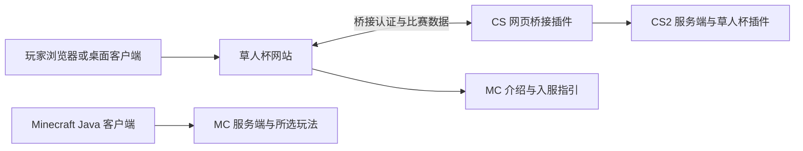

# 开始之前

[返回目录](README.md) · [下一章](02-environment.md)

## 先理解组成



网站和游戏可以放在同一台机器，也可以分开部署。先按同机地址跑通，分机时按[联通章节](06-integration.md)配置桥接可达的 HTTPS 地址。

| 名词 | 简单解释 |
|---|---|
| 服务端或服务器程序 | 接收玩家连接、运行世界或比赛的程序 |
| 服务器机器 | 运行程序的电脑，可以是自己的电脑、虚拟机或云主机 |
| Release | 维护者打包好的发行版本，通常可直接安装 |
| 源码 ZIP | 编程文件，需要编译的项目还要先构建 |
| 端口 | 一台机器上区分不同服务的编号，还需区分 TCP、UDP |
| 桥接插件 | 让 CS2 与网站交换比赛数据和操作的插件 |
| 环境变量 | 在启动程序时传入的配置，本项目由进程环境读取这些值 |
| 运行数据 | 账号、会话、比赛状态、偏好、数据库、MC 世界与玩家存档 |

## 下载什么

在同一个 Release 页面下载所需附件，核对版本号和发布说明。GitHub 自动生成的 Source code 附件用于源码路线。网络不便时可在 Windows 下载后上传。[发行版本](https://github.com/GrassBl0ck/caoren-cup/releases)

| 附件前缀 | 用途 | 还需要自己准备 |
|---|---|---|
| `CaorenCupServer-服务器插件合集-` | CS 插件及共享契约 | CS2 本体、框架、按功能需要的第三方组件与资源 |
| `CaorenCupWeb-网页端-` | 共用网站 | Node.js、npm、邮箱 SMTP，公网使用 HTTPS |
| `CaorenCupMC-服务器内容-` | MC 玩法插件、数据包、源码与下载工具 | Java、相应游戏服务端、世界与大资源 |
| `CaorenCupUpdate-` | 指定模块的局部更新 | 先核对基础版本、接口及配套资源要求 |

服务器插件包的 `addons/` 对应 CS2 的 `game/csgo/addons/`。MC 包的每个玩法分别安装。安装目录树见对应章节，先解压到单独的暂存文件夹查看。

## 环境和依赖

| 部分 | 本教程基准 | 证据与限制 |
|---|---|---|
| 操作端 | Windows、PowerShell 7、浏览器 | 本机终端与远程终端要分清 |
| Linux 服务端 | Ubuntu 24.04 x86_64 | 全新环境端到端待实测 |
| Windows 服务端 | Windows x64、PowerShell 7 | 全部部署流程未验证 |
| 网站 | Node.js 22 LTS、完整 npm 依赖 | 原 CI 使用 Node 20，迁到 22 的部署需实测 |
| CS 运行 | 与当前 CS2 匹配的 MetaMod、CounterStrikeSharp with-runtime | 历史版本组合只作追溯，详见版本页 |
| CS 编译 | .NET 10 SDK 与 .NET 8 SDK | 安装发行包时通常使用框架附带运行时 |
| MC 自研玩法运行和编译 | Java/JDK 25、对应 Paper 26.3 API | 依具体玩法核对版本与验收状态 |
| MC 资源下载 | Python 3.12 | 仅下载第三方大资源或使用构建工具时需要 |

Node 20 已结束官方维护，新部署选择仍受支持的 LTS。教程采用 Node 22 以便与现有本地检查环境衔接，完整兼容性以自己环境测试为准。[Node 发布状态](https://nodejs.org/en/about/previous-releases)

## 创建部署记录

在自己的电脑创建一份私人记录，填写所选 Release、下载文件名、SHA-256、系统、游戏与框架版本、安装目录、对外地址、端口和测试结果。密码与 Token 使用密码管理器保管。

Windows 下载文件后，在文件所在目录执行，替换文件名。

```powershell
Get-FileHash -LiteralPath '.\CaorenCupWeb-网页端-v2.2.1.zip' -Algorithm SHA256
```

结果应为 64 位十六进制摘要。与发布者提供的摘要比较。仅自己计算出的摘要可用于核对传输前后的一致性，其可信来源仍需要确认。

磁盘要同时容纳游戏、Steam 更新临时空间、世界和备份。CS2 的空间需求随游戏更新变化，下载前核对当前要求。MC 的内存参数需给操作系统及同机网站、CS2 留出余量，后文 `2G` 只是启动示例。
